# 自転車工具セット：原创图片与日文文案草稿

参考ASIN：B0HDCNXSDL。用户确认以聊天上传的工具图片为准。

下载本目录的 bicycle-tools-complete.zip 即可取得12张图片、Word文案及说明；或在仓库首页选择 Code → Download ZIP。

7张2000×2000，5张1940×1200。图片为AI原创视觉草稿，发布前须核对真实采购品，尤其工具形状、齿槽、螺纹、链节及适配。尺寸来自参考页面图示，非实物测量。用户仅提供4个关键词，无流量、出单或供需比指标。

不含竞品原图或下载的参考页面文件。详情见 Word 与文本核对记录。

## 图片预览

已优化日文无衬线字形、字号、留白和红灰配色。以下为草稿预览，结构须与实物核对。

### 01_main_white

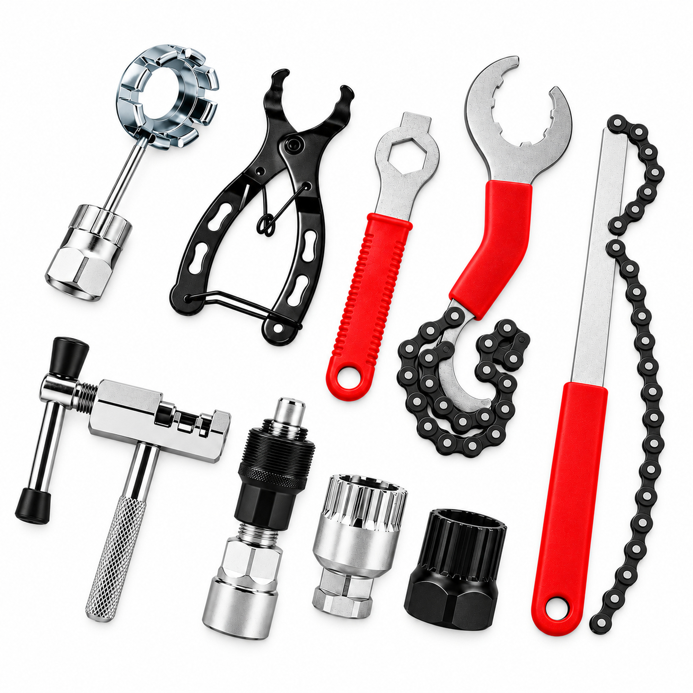

### 02_set_overview

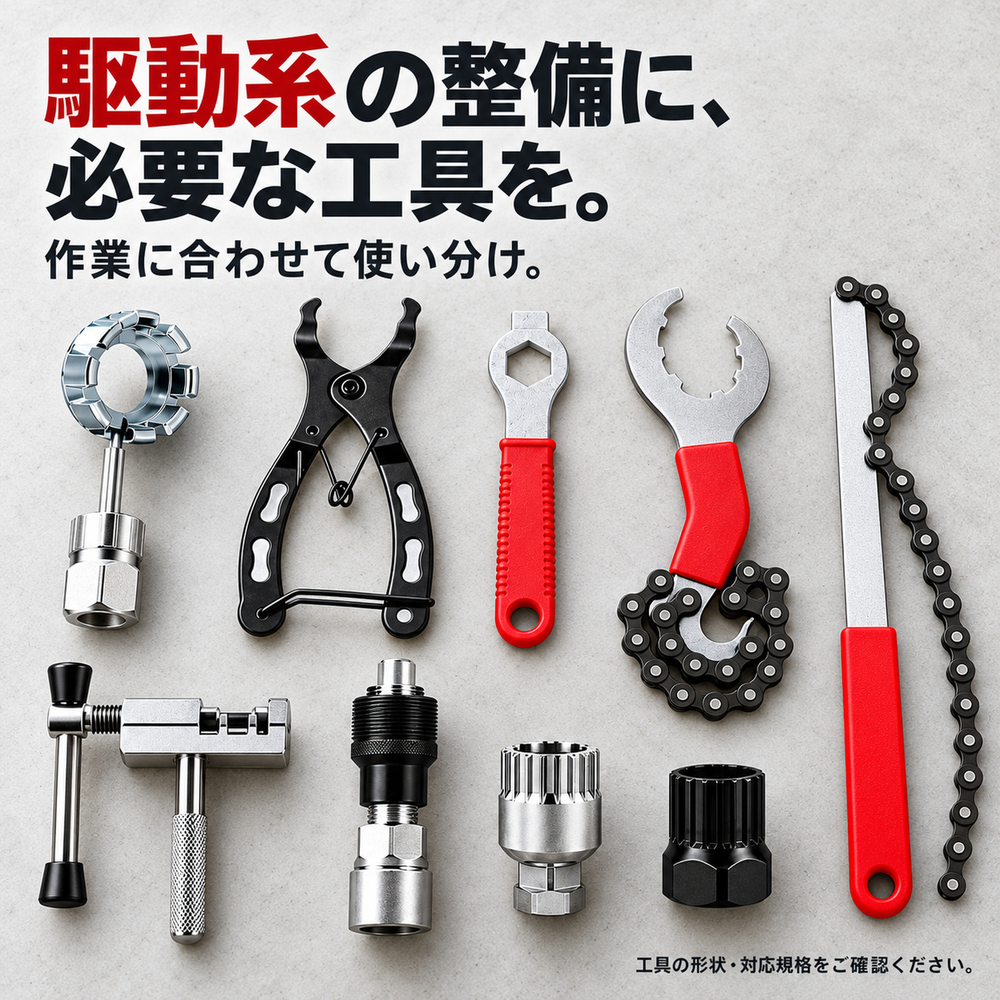

### 03_sprocket_holder

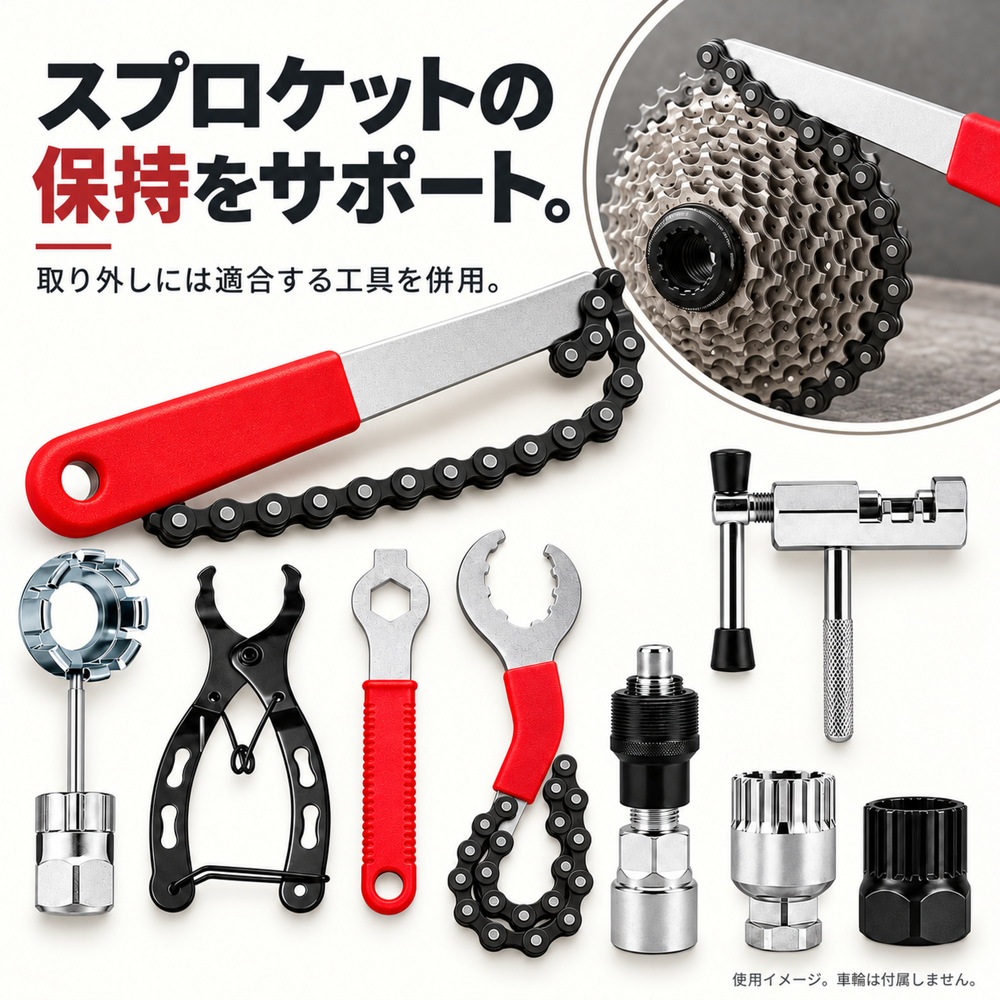

### 04_chain_tools

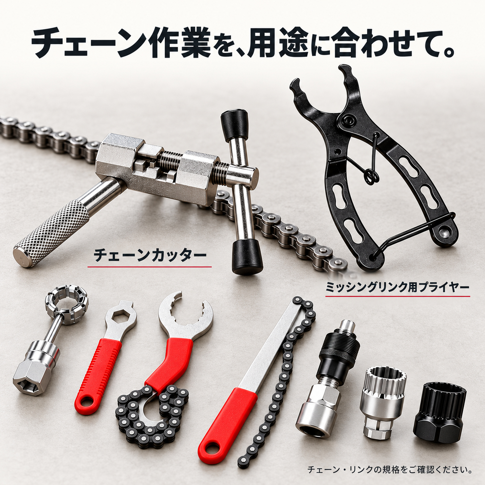

### 05_crank_bb_tools

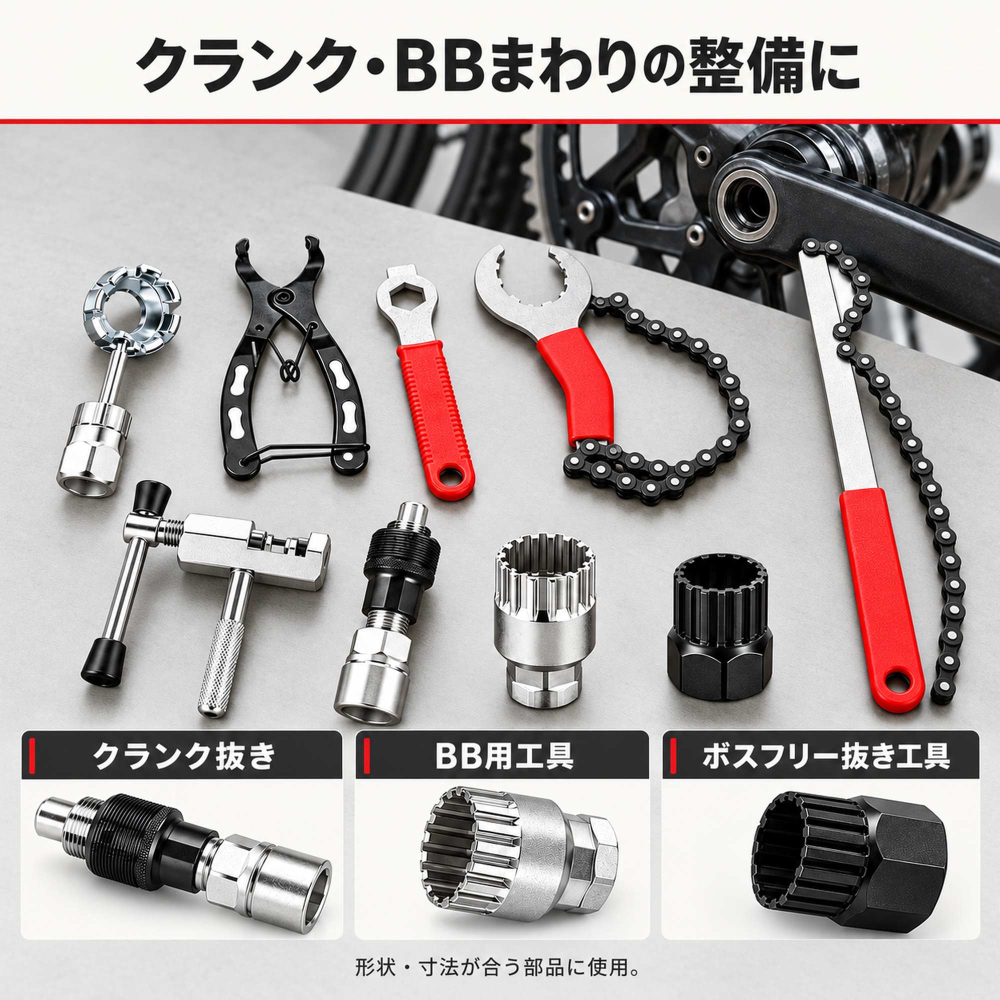

### 06_japanese_workshop

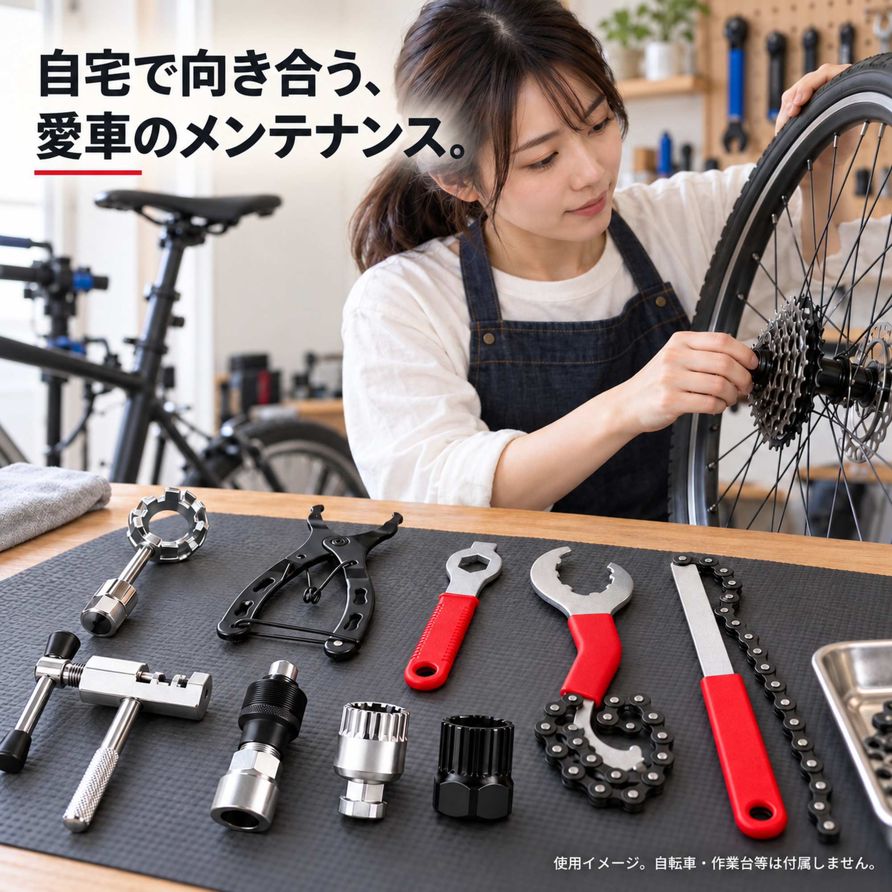

### 07_reference_sizes

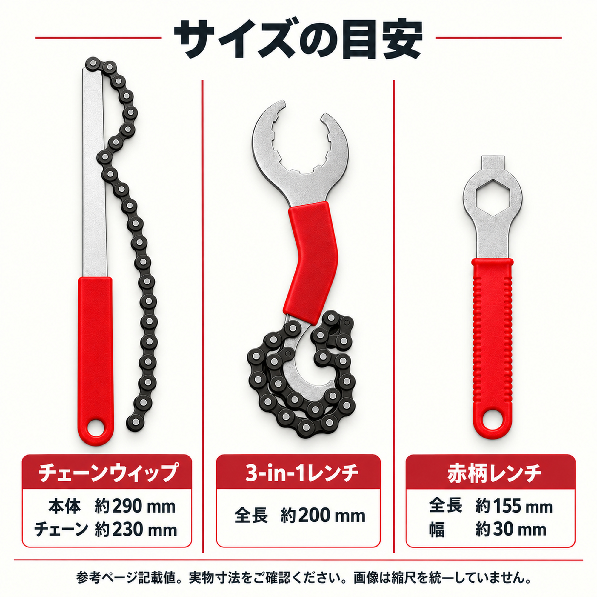

### 08_detail_hero

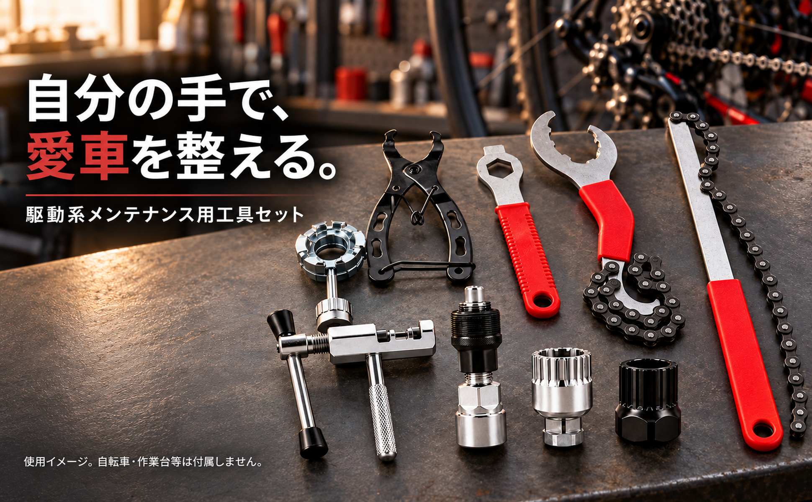

### 09_detail_sprocket

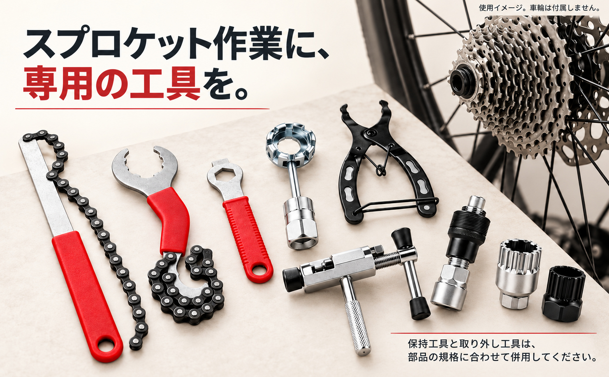

### 10_detail_chain

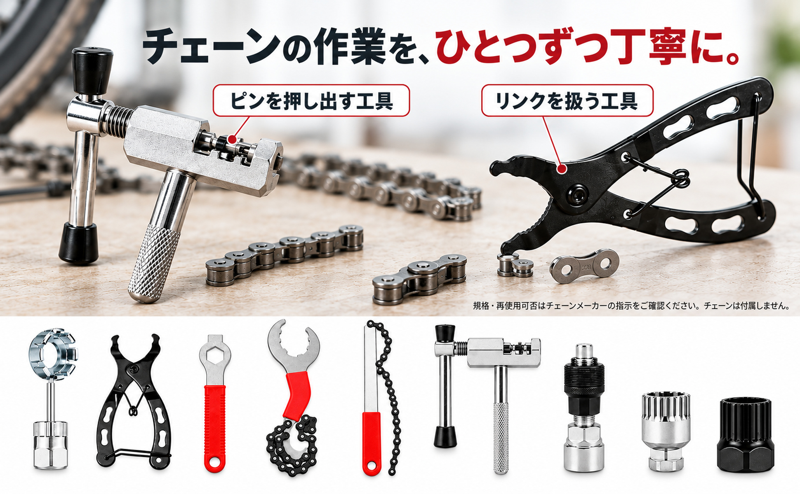

### 11_detail_hardware

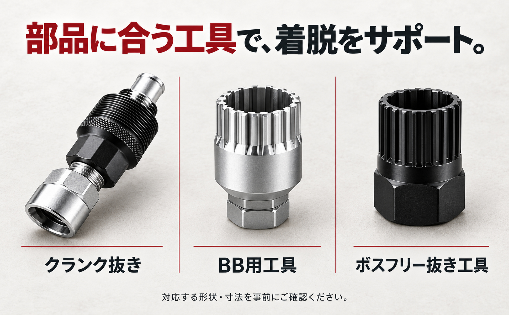

### 12_detail_preparation

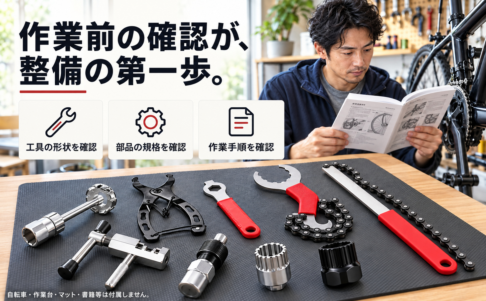

